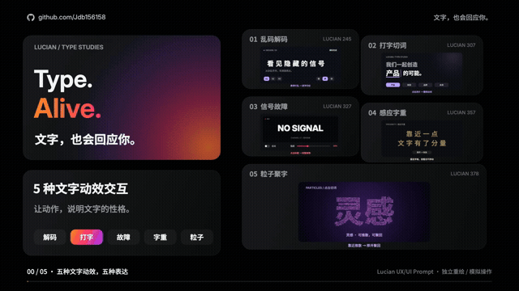

# Type. Alive. · 文字，也会回应你。

**[打开交互网页](https://jdb156158.github.io/vibe-textAlvie/) · [观看完整视频](https://jdb156158.github.io/vibe-textAlvie/#film) · [下载 MP4](media/type-microinteractions-20s.mp4) · [下载影片源码](media/type-microinteractions-source.zip)**

## 视频展示

[](https://jdb156158.github.io/vibe-textAlvie/#film)

1920×1080 / 60fps / 20 秒。左上角全程显示 GitHub 图标与 github.com/Jdb156158。

## 可交互网页

|控件|操作|场景|
|---|---|---|
|乱码解码|悬停 / 点击重播，换句、调速度|科技首页|
|打字切词|点击关键词，删旧再输入；可开启自动轮换，悬停暂停|品牌介绍|
|信号故障|点击触发、拖动滑杆调强度，可开启自动模式|活动专题|
|感应字重|跟随指针距离变粗，点击反转，移开复原|创意作品集|
|粒子聚字|移动推散，移开聚回，点击或 Enter 换词|产品发布|

支持触屏点按、键盘、重置与减少动态效果。触屏的粒子交互以点按换词为主，保留页面纵向滚动。

## 本地运行

```sh
python3 -m http.server 4859
```

打开 http://localhost:4859/。网页无需构建，全部字体和依赖本地提供。

## 文件

- `index.html` / `site/`：实际交互网页。
- `film/`：可编辑影片、渲染脚本、音轨、字体和许可。
- `media/`：MP4、GIF、截图与影片源码 ZIP。
- `docs/`：完整提示词、制作步骤与验收记录。

## 制作提示词

```text
用代码制作 20 秒、1920×1080、60fps 的知识短片。
主题是五种文字动效交互：Lucian 245 / 307 / 327 / 357 / 378。
沿用系列黑色 Bento 布局、Inter 大标题、中文短句和橙粉紫标题渐变；控件内部保留原站配色。
第一帧五种控件和标题全部出现；顶部常驻“文字，也会回应你。”，所有控件编号清楚。
0–2 秒总览，2–5 解码，5–8 打字，8–11 故障，11–14 字重，14–17 粒子，17–20 总结。
每项用一块场景卡、一块简短 AI 提示词卡，以及放大的操作演示讲清机制；其他四项留在缩略带。
解码固定字符格，字符必须全部归位；打字先删除再输入；故障短促并恢复；字重跟随指针距离；粒子在换词后停留清晰字形。
中文文案独立重写，不把原站截图剪进视频。Canvas 暴露确定性的 window.draw(t)，无真实时钟、无不带种子的随机数，字体和库本地加载。
120 BPM、2/4 拍，首拍 0 秒，所有章节起点对齐小节；Python 合成配乐、按键、故障和聚合音效；18 秒收束和弦，最后 0.8 秒淡出。
先九帧截图检查并至少修改两轮，再用 Playwright 逐帧输出 1,200 张 JPG，以 FFmpeg 编码 H.264 yuv420p + AAC、faststart 和每秒关键帧。
抽取真实 MP4 帧检查，并验证完整播放、跳转，交付 MP4 与可复现源码。
```

## 五项完整提示词


### 01 乱码解码标题
为科技产品首页制作可交互的解码标题。悬停时把字符暂时替换为随机符号，再由左到右逐个恢复原文；固定字符位置避免布局抖动。提供切换句子和慢、中、快三档速度，减少动态模式直接显示结果，触屏点按也能触发。

### 02 打字切词标题
为品牌介绍页制作末尾关键词轮换标题。保留句子主体，只删除并逐字输入关键词，光标在等待时闪烁，输入时保持常亮，关键词和下划线颜色同步变化。点击词片立即切换，悬停暂停自动轮播；预留最长词的宽度，避免页面跳动。

### 03 信号故障标题
为音乐活动或游戏专题制作信号故障标题。点击时将文字切成几条水平带，短暂错位并产生红青通道分离，随后恢复清晰。提供强度滑杆与自动模式，控制闪动频率和持续时间；减少动态模式只保留短暂色彩反馈。

### 04 靠近变粗文字
为创意作品集制作感应字重标题。根据每个字与鼠标的距离平滑改变粗细、亮度和轻微缩放，使用固定宽度字格，避免文字挤动。点击可切换为靠近变细，离开后恢复默认字重；触屏按下同样有反馈，并提供减少动态模式。

### 05 粒子聚字
为产品发布页制作粒子文字。采样文字像素作为粒子目标位置，让粒子弹性聚合成词；鼠标靠近时推散附近粒子，移开后回到原位，点击平滑迁移成下一个词。使用固定种子，限制粒子数量和计算量；确保静态替代文字可访问，减少动态模式直接切词。

## 制作步骤与复现

1. 核对 Lucian 目录及公开控件 HTML/JS，确认触发方式和结果；逐条来源与分镜见 [分镜与来源](film/treatment.md)。
2. 使用确定性的 Canvas 绘制五种 UI。粒子目标从本地中文字体像素采样；种子函数固定，正放与跳帧相同。
3. 九帧检查后两轮修改：修正解码最后一字归位；粒子换词过渡从 0.9 秒改为 0.7 秒，增加结果阅读时间，迁移期间单独显示状态。
4. Python / numpy 合成 120 BPM 配乐和与操作同步的音效，限制峰值；FFmpeg 响度处理后封装 AAC。
5. Playwright 逐帧调用 draw(i/60)，JPG 输出后编码 MP4。最终抽帧、完整播放与跳转验收见 [影片验收](film/QA.md)。

```sh
# 需要 Node.js、Python 3 + numpy、Chrome、FFmpeg
cd film
npm install
python3 make_audio.py
npm run stills
npm run render
sh encode.sh
```

渲染脚本默认使用 macOS Chrome。其他平台设置 `CHROME_PATH` 指向本机 Chrome。可选 `FRAME_DIR` 自定义帧目录。

```sh
# 使用已安装 huashu-motion 时，可打开可定位帧的编辑工作台
om studio . --no-open
```

`film/index.html` 是影片时间轴，供播放、跳转和修改画面。影片中的指针操作由时间驱动，实际交互网页位于仓库根目录。

## 文件

- `index.html`：所有画面、时间轴、短提示词、粒子采样和 draw(t)。
- `render.mjs` / `encode.sh`：逐帧渲染和 MP4 编码。
- `make_audio.py` / `assets/sound.wav`：配乐和音效。
- `assets/fonts` / `vendor`：本地字体与库及其许可。
- `treatment.md` / `QA.md`：来源、完整提示词、分镜、验收。

## 参考与许可

交互参考 [Lucian UX/UI Prompt](https://lucianlabs.dev/uxui-prompt/) 的 245、307、327、357、378，布局沿用系列已确认的 [Bento Grid](https://guanmo-ai.github.io/design-style/?lang=zh#work-01-bento-grid)。UI、中文文案、动画、音轨独立编写；原站截图不作为视频素材。字体及库的许可随包保留。
